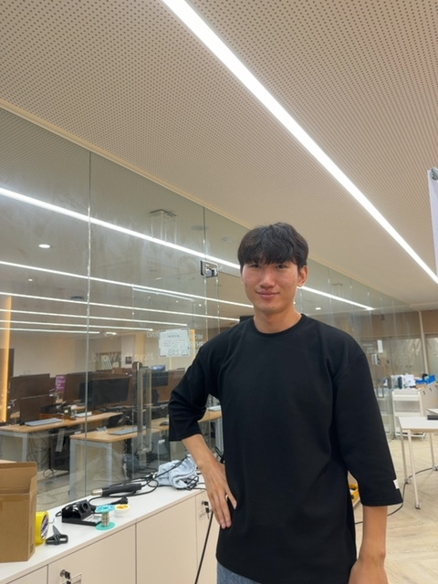
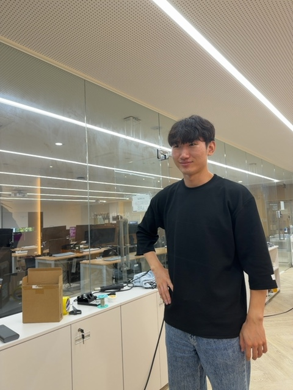
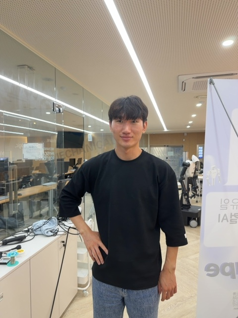
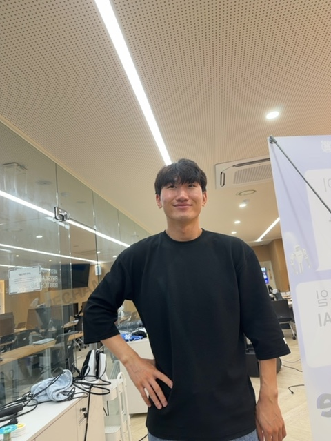
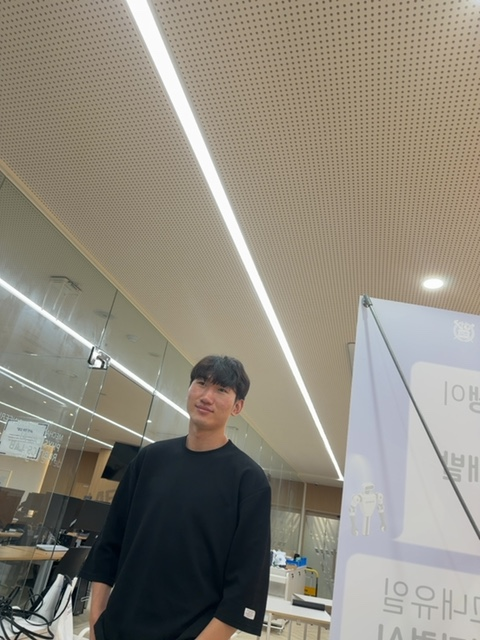
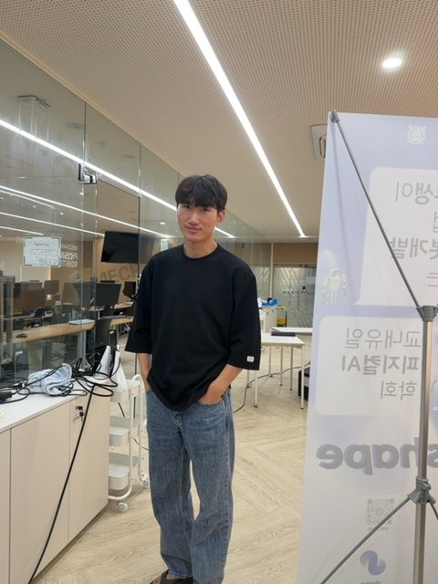
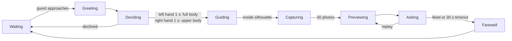
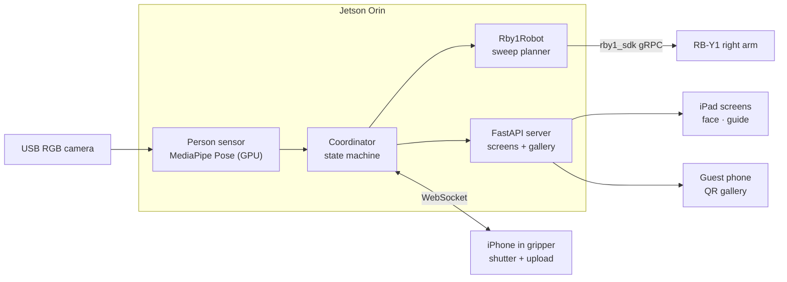
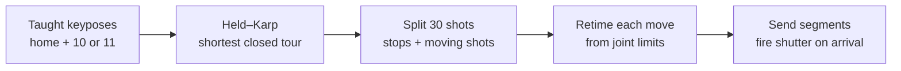

<div align="center">

# RB-Y1 Photographer Robot

**Live demo · Opening ceremony of an SNU robotics institute · Aug 2026**

A kiosk robot that greets guests, guides them into a framing silhouette by camera,<br>
and sweeps a phone held in the RB-Y1's right gripper through taught poses to shoot 30 photos.


<table>
  <tr>
    <td></td>
    <td></td>
    <td></td>
    <td></td>
    <td></td>
    <td></td>
  </tr>
</table>

<sub>Frames the robot shot of one guest during a single sweep at the event.</sub>

</div>

<br>

| **Sessions** | **Photos** | **Failed captures** | **Shots / guest** | **Taught keyposes** |
|:---:|:---:|:---:|:---:|:---:|
| **27** | **810** | **0** | **30** | **11 full-body · 10 upper-body** |

<sub>Counted from the photos saved on the robot over two days of rehearsal and the event.</sub>

---

## Demo

https://youtu.be/OhhxrzGfgDo

---

## Based on GeekSeek

This project is adapted from **GeekSeek**, built by team GeekSeek from MeRo at SNU (김민재, 박상원, 강채은) for the 1st Robot Hackathon hosted by Roboticus (Aug 5–8, 2026, KAIST).

| | Original GeekSeek | This project |
|---|---|---|
| **Robot** | Phorce arm | Rainbow Robotics RB-Y1 (Model A), right arm |
| **Motion** | Motions pre-loaded as slots on the controller's SD card, played with `play(slot)` | Joint-position commands sent through `rby1_sdk` |
| **Shot timing** | Baked into each motion slot | Fired when each commanded segment actually completes |
| **Mode selection** | iPad buttons | Hand-raise gesture |
| **Venue** | Hackathon booth, KAIST | Opening ceremony, SNU |

- Original repository: https://github.com/robotic-us/1st-robot-hackathon_geekseek
- The eight-stage kiosk workflow, MediaPipe pose tracking, silhouette framing guidance, iPad screens, phone shutter over WebSocket, QR gallery and Claude-generated greeting all come from the original project.
- Intellectual property of the original project belongs to the GeekSeek team (all members), as stated in the original repository.

---

## How a session runs



1. **Waiting → Greeting.** MediaPipe on the Jetson sees a guest walk up, and the kiosk greets them with a line generated by Claude from the camera frame.
2. **Deciding.** The guest holds up the left hand for one second for a full-body shot, or the right hand for an upper-body shot. The chosen option on screen fills up while the hand is held.
3. **Guiding.** The guide screen tells the guest to step forward, back, left or right until their pose lands inside the silhouette recorded for that mode.
4. **Capturing.** The guest lowers the hand and raises it again to say they are ready. After a 3-2-1 countdown, the arm sweeps the phone through the taught poses and the phone shoots 30 photos.
5. **Previewing → Farewell.** The photos play back as a slideshow, a QR code opens a gallery with only this guest's photos, and the kiosk says goodbye.

## System



| Module | What it does |
|---|---|
| [`src/geekseek/workflow.py`](src/geekseek/workflow.py) | Eight-stage state machine. Every transition goes through `apply_event()`, so invalid events are rejected in one place |
| [`src/geekseek/coordinator.py`](src/geekseek/coordinator.py) | Runs the sense loop, gesture and ready detection, timers and the photo burst |
| [`src/geekseek/perception.py`](src/geekseek/perception.py) · [`framing_guide.py`](src/geekseek/framing_guide.py) | Pose landmarks, approach and hand-raise signals, and silhouette matching against recorded framing samples |
| [`src/geekseek/robot.py`](src/geekseek/robot.py) · [`rby1_keyposes.py`](src/geekseek/rby1_keyposes.py) | RB-Y1 adapter, keypose compiler and sweep execution (plus the original Phorce, RViz and fake robots) |
| [`src/geekseek/capture.py`](src/geekseek/capture.py) · [`gallery.py`](src/geekseek/gallery.py) | Phone shutter over WebSocket and the per-guest QR gallery |
| [`web/`](web/) | Kiosk screens (`/face`, `/guide`, `/standby`), the phone camera page and the operator debug page |
| [`scripts/`](scripts/) | Teaching, keypose building, replay, diagnostics and drive tools for the RB-Y1 |

---

## Porting to the RB-Y1

### Teaching camera poses

Phorce joint values cannot be copied to the RB-Y1. The two arms have different kinematics, so the same numbers would neither reproduce the camera path nor stay inside the joint limits. Instead, the final camera compositions were taught directly on the RB-Y1 with the phone already in its gripper.

1. **Record.** [`scripts/rby1_pose_capture_server.py`](scripts/rby1_pose_capture_server.py) runs on the Jetson. The iPhone opens `/phone` and the laptop opens `/operator`. Pressing Space stores the phone's current frame together with the right-arm joint state. This tool never commands the robot.
2. **Split.** [`scripts/build_rby1_shot_keyposes.py`](scripts/build_rby1_shot_keyposes.py) turns one teaching session into a home pose plus **11 full-body** and **10 upper-body** keyposes. Any recorded encoder value outside the RB-Y1 Model A joint limits is clamped 0.5° inside them, and each clamp is logged in the output file.

### Planning the sweep



- **Exact tour.** [`rby1_keyposes.py`](src/geekseek/rby1_keyposes.py) solves `home → every keypose → home` exactly with a Held–Karp dynamic program instead of nearest-neighbour. The cost of a move is the travel of its slowest joint. Pose pairs listed in `planning.blocked_edges` are never connected.
- **30 shots per guest.** The arm stops for 0.1 s at each keypose to take one photo, and the remaining shots are spread over the moves between keyposes in proportion to their length. That is 11 stops + 19 moving shots for full body, and 10 stops + 20 moving shots for upper body.
- **Limit-aware retiming.** At runtime each move is timed from the right arm's joint velocity and acceleration limits, scaled to 70% and 50%, using a per-joint trapezoidal profile with a 10% margin. A move that carries moving shots is also kept long enough for the phone to fire them all.
- **Shots on arrival.** Shots are triggered from the actual completion of each SDK command instead of a wall-clock schedule, so RPC latency cannot push a shot outside its stop. Phone captures are serialized without holding the arm.

### Safety

- The software never powers on the robot or enables servos. On startup it only checks that the Control Manager is enabled, then returns to the taught home pose.
- Old continuous-recording trajectory files are refused, so a stale file can never be replayed on the robot.
- If a sweep fails, the adapter asks the SDK to cancel control. The physical stop is the EMO.
- The hand used to pick the shot mode must be lowered before a new raise can start the arm, so one long raise cannot both choose a mode and start the robot.
- The capture is refused before the countdown if the phone's WebSocket is not connected.

---

## Running

```bash
python3 -m pip install -e '.[rby1,dev]'
cp config/jetson-rby1.example.yaml config/jetson-rby1.yaml
python3 -m geekseek --config config/jetson-rby1.yaml
```

Without a robot, `python3 -m geekseek --config config/dev.yaml` runs the kiosk with a fake robot.

| Doc | Contents |
|---|---|
| [`docs/RBY1_MIGRATION.md`](docs/RBY1_MIGRATION.md) | RB-Y1 port: keypose teaching, tour planning, EEF and F/T sensor notes, mobile base driving |
| [`docs/RBY1_RUNBOOK.md`](docs/RBY1_RUNBOOK.md) | Step-by-step bring-up on the day |
| [`docs/FINAL_METHOD.md`](docs/FINAL_METHOD.md) | Original Phorce setup from the hackathon |

HTTPS certificates (`certs/`) and the public tunnel hostname (`<your-tailnet>.ts.net` in `config/`) are not included. Guest photos, logs and CAD files are also left out.

## Limitations and next steps

- **Cancellation on shutdown.** A sweep cancelled by stopping the server does not call `cancel_control()`, so the arm finishes its current segment and stays at that pose. It should also cancel on `asyncio.CancelledError`.
- **No return after a failure.** After a failed sweep the arm stays where it stopped until the next session starts from home.
- **Camera extrinsics.** The `ee_right → phone camera` transform is still uncalibrated, so re-gripping the phone shifts every composition. A repeatable fixture with a stopper is needed.
- **Ready timeout.** If no ready gesture is seen within 12 s, the capture starts anyway. On a real robot an operator confirmation would be safer.
